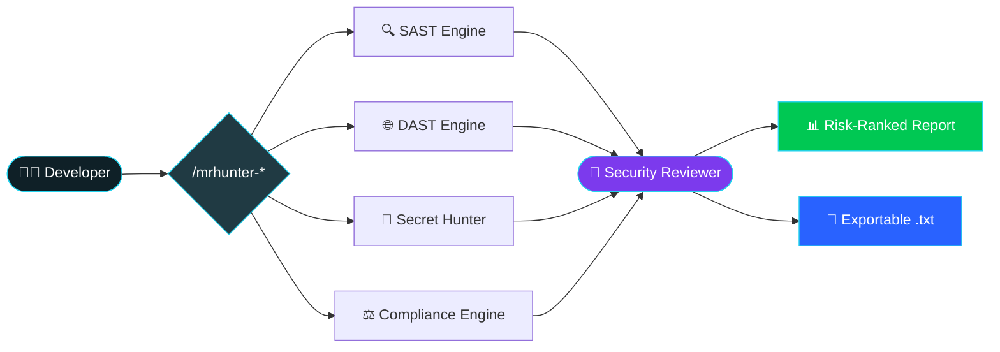

<div align="center">

<!-- ══════════════════════ ANIMATED HEADER ══════════════════════ -->


<!-- ══════════════════════ TYPING ANIMATION ══════════════════════ -->
<a href="#-quick-start">
  
</a>

<br/>

<!-- ══════════════════════ BADGES ══════════════════════ -->


<br/>


<br/><br/>

<!-- ══════════════════════ ACTION BUTTONS ══════════════════════ -->
<a href="#-quick-start"></a>
<a href="#-commands"></a>
<a href="#-why-teams-choose-mrhunter"></a>
<a href="https://github.com/TheWildEye/MrHunter2/issues"></a>
<a href="#-credits"></a>

<br/><br/>

> ### 🛡️ The security & compliance brain that lives inside your editor.
> **No servers. No API keys. No cloud. No noise.** Just open your project, type a command, and get a board-ready security and compliance verdict in seconds.


</div>

---

<div align="center">

## 🎬 See It In Action

<a href="#-quick-start">

</a>

<sub>⬆️ a live MrHunter scan, from one command to a board-ready verdict in seconds</sub>


</div>

---

<div align="center">

## 🏆 Trusted Where It Counts

<table>
<tr>
<td align="center" width="25%">
<h1>150K+</h1>
<b>Businesses Protected</b><br/>
<sub>across the platforms we've secured</sub>
</td>
<td align="center" width="25%">
<h1>10+</h1>
<b>Products Audited</b><br/>
<sub>security &amp; GRC end-to-end</sub>
</td>
<td align="center" width="25%">
<h1>100+</h1>
<b>Vulnerabilities Found</b><br/>
<sub>critical, high &amp; compliance</sub>
</td>
<td align="center" width="25%">
<h1>50+</h1>
<b>GRC Audit Reports</b><br/>
<sub>shipped to leadership</sub>
</td>
</tr>
</table>

> 💪 **Battle-tested at Petpooja, India's largest F&amp;B SaaS platform**, where the MrHunter engine was first hardened against real-world, high-scale production code.

<br/>

**🛰️ Trusted across industries**


</div>

---

<div align="center">

## 🚨 The Reality Most Teams Ignore

</div>

<table>
<tr>
<th>❌ The Old Way</th>
<th>✅ The MrHunter Way</th>
</tr>
<tr>
<td>Security reviews happen <b>after</b> the sprint</td>
<td>Security is <b>inside</b> the editor, as you build</td>
</tr>
<tr>
<td>₹ lac / $ k spent on heavyweight scanner licenses</td>
<td><b>Zero infrastructure.</b> Zero license fees. Zero API keys.</td>
</tr>
<tr>
<td>500-line reports nobody reads</td>
<td><b>Plain-English verdicts</b> managers &amp; CISOs actually act on</td>
</tr>
<tr>
<td>Compliance discovered at audit time 😱</td>
<td>DPDP, PCI DSS, CERT-IN &amp; more checked <b>on every scan</b></td>
</tr>
<tr>
<td>Findings without proof</td>
<td><b>Evidence-first:</b> exact file, line, and data flow</td>
</tr>
</table>

---

<div align="center">

## ✨ What MrHunter Does

> **Five specialized AI engines. One command. A complete security posture.**


</div>

<table>
<tr>
<td width="50%" valign="top">

### 🔍 SAST: Static Analysis
Deep code reasoning across **Python, JS/TS, Java, Go, PHP, Ruby, Kotlin &amp; Swift**.
- SQLi, Command Injection, XSS, SSRF, XXE, deserialization, path traversal &amp; more
- **Taint tracing**, follows the data from user input to the dangerous sink
- **Logic-over-patterns** engine: fewer false positives, more real bugs

</td>
<td width="50%" valign="top">

### 🌐 DAST Simulation
Runtime attack simulation with **zero network calls**.
- Models REST, GraphQL, WebSocket, gRPC &amp; OAuth/OIDC flows
- Simulates auth bypass, BOLA/IDOR, mass assignment, race conditions
- Traces **full exploit chains**, not isolated symptoms

</td>
</tr>
<tr>
<td width="50%" valign="top">

### 🔑 Secret Hunter
Scans **every file**, source, scripts, notebooks, `.env`, and gitignored files.
- **35+ credential types:** AWS, GCP, Azure, Stripe, Razorpay, OpenAI, Anthropic, Gemini, Slack, private keys &amp; more
- Flags **gitignored vs. committed** so you know the blast radius instantly

</td>
<td width="50%" valign="top">

### ⚖️ Compliance Engine
Global standards plus seven Indian regulatory frameworks, mapped to your actual code.
- ISO/IEC 27001 · NIST SP 800-53
- DPDP Act 2023 · IT Act 2000 · PCI DSS 4.0.1
- CERT-IN 2022 · RBI · SEBI CSCRF · IRDAI
- **Exact control/section + penalty exposure** for every finding

</td>
</tr>
<tr>
<td colspan="2" valign="top">

### 🧠 Security Reviewer: The Triage Layer
Deduplicates, cross-references and **risk-ranks** everything the other engines find.
- CVSS v4.0 + OWASP Risk Rating scoring
- Removes false positives, verifies reachability, separates *real* from *theoretical*
- Produces **one board-ready report**, technical depth for engineers, plain English for leadership

</td>
</tr>
</table>

---

<div align="center">

## 🔌 Bring Your Own Agent (BYOA)

> **MrHunter is agent-agnostic.** It's a portable security &amp; compliance brain you can drop into **any** AI coding agent you already use, no lock-in, no new tool to learn.


</div>

<table>
<tr>
<td width="50%" valign="top">

### 🧩 Plugs into the agents you already love
- 🟣 **Claude Code**
- ✨ **Gemini / Antigravity**
- 🤖 **ChatGPT Codex**
- ⚡ **OpenCode**
- 🧠 **Cursor · Windsurf · Cline** &amp; more

</td>
<td width="50%" valign="top">

### 🚀 Why teams pick BYOA
- **No lock-in**, your agent, your choice
- **One skill pack, every agent**, write once, run anywhere
- **Zero infra**, runs locally, inside your editor
- **Future-proof**, swap agents anytime, keep MrHunter

</td>
</tr>
</table>

<sub>Same engines. Same reports. Same compliance verdicts, whichever agent you point at your code.</sub>

---

<div align="center">

## 🏛️ Audit &amp; GRC: Governance, Risk &amp; Compliance

> MrHunter isn't just a scanner, it's a **GRC co-pilot**. It turns raw code findings into **audit-ready evidence**, maps every issue to a control framework, and quantifies the **business &amp; legal risk** leadership cares about.

 
 


<br/>


<br/>

### 🌍 Global standards
| Standard | What MrHunter Maps | Why It Matters |
|---|---|---|
| 🔒 **ISO/IEC 27001** | Access control, cryptography, logging &amp; monitoring, secure SDLC (Annex A controls) | Clears enterprise &amp; vendor security questionnaires |
| 🧭 **NIST SP 800-53** | AC · AU · SC · SI · RA control families | Required for regulated &amp; government procurement |

###  Indian regulatory frameworks
| Framework | What MrHunter Checks | Why It Matters |
|---|---|---|
|  **DPDP Act 2023** | Consent, children's data, breach readiness, erasure | Penalties up to **₹250 Cr** |
|  **IT Act 2000** | SPDI safeguards, disclosure, confidentiality | Criminal + civil liability |
| 💳 **PCI DSS 4.0.1** | PAN/CVV storage, TLS, MFA, logging | Card-brand fines &amp; suspension |
| 🛡️ **CERT-IN 2022** | 6-hour reporting, 180-day logs, NTP, MFA | Statutory obligation |
| 🏦 **RBI Cyber 2024** | Device binding, tokenization, rate limits | PSS Act penalties |
| 📈 **SEBI CSCRF** | Data classification, SOC, VAPT, SBOM | Exchange + SEBI action |
| 🏥 **IRDAI Cyber** | PII/health encryption, board policy, VAPT | Discretionary + IT Act |

### 📋 Built for audit season
- **Evidence-first** findings (file + line + data flow), defensible in a VAPT report
- **Control mapping**, every finding ties to a framework control
- **Penalty exposure in ₹ / $**, plain-English risk for the board
- **One-click audit report export**, hand it straight to auditors &amp; leadership


</div>

---

<div align="center">

## 🏗️ Architecture

> **One command fans out to five engines. One reviewer unifies the verdict.**

</div>



```
your-project/
├── opencode.json                 # Registers the 5 subagents
├── AGENTS.md                     # Session context (auto-loaded)
└── .opencode/
    ├── commands/                 # Slash command entry points
    ├── agents/                   # The 5 reasoning engines
    └── skills/                   # OWASP · CWE · Mobile · Legal knowledge
```

---

<div align="center">

## 🛡️ Built on Zero Trust

> MrHunter follows a **Zero Trust** model, *never trust, always verify*, applied to the scanner itself. Nothing about your code, secrets, or findings is implicitly trusted with any external system.


</div>

| Zero Trust Pillar | How MrHunter Proves It |
|---|---|
| **Verify explicitly** | Every finding is evidence-first, a verified `source → sink` data flow, never a keyword guess |
| **Least privilege** | Runs as a local, read-only agent, `edit`, `bash` and `webfetch` are **denied** by default |
| **Assume breach** | Treats all input as hostile, prompt injection, malicious files and payloads are neutralized, not trusted |
| **No implicit network trust** | **Zero external calls** during scans, no code, secrets or findings ever leave your machine |
| **Continuous verification** | A fresh scan every session, stale findings are never reused or trusted |
| **No shared trust** | No cloud, no telemetry, no third-party dependency in the scan path |

<sub>No servers. No telemetry. Nothing leaves your machine, a zero-trust, local-first agent by design.</sub>

---

<div align="center">

## ⚡ Quick Start

> **60 seconds from clone to your first scan. No `npm install`. No `pip install`. No API keys.**

### 🅰️ Install in one project

**macOS / Linux**
```bash
git clone --depth 1 https://github.com/TheWildEye/MrHunter2.git _mrhunter && \
cp -r _mrhunter/MrHunter/.opencode ./ && \
cp _mrhunter/MrHunter/opencode.json _mrhunter/MrHunter/AGENTS.md ./ && \
rm -rf _mrhunter
```

**Windows (PowerShell)**
```powershell
git clone --depth 1 https://github.com/TheWildEye/MrHunter2.git _mrhunter
Copy-Item -Recurse _mrhunter/MrHunter/.opencode ./
Copy-Item _mrhunter/MrHunter/opencode.json, _mrhunter/MrHunter/AGENTS.md ./
Remove-Item -Recurse -Force _mrhunter
```

### 🅱️ Install globally (works in every project)

**macOS / Linux**
```bash
git clone --depth 1 https://github.com/TheWildEye/MrHunter2.git _mrhunter && \
mkdir -p ~/.config/opencode/agent ~/.config/opencode/command ~/.config/opencode/skill && \
cp -r _mrhunter/MrHunter/.opencode/agents/.   ~/.config/opencode/agent/ && \
cp -r _mrhunter/MrHunter/.opencode/commands/. ~/.config/opencode/command/ && \
cp -r _mrhunter/MrHunter/.opencode/skills/.   ~/.config/opencode/skill/ && \
rm -rf _mrhunter
```

**Windows (PowerShell)**
```powershell
git clone --depth 1 https://github.com/TheWildEye/MrHunter2.git _mrhunter
$dest = "$HOME/.config/opencode"
New-Item -ItemType Directory -Force -Path "$dest/agent","$dest/command","$dest/skill" | Out-Null
Copy-Item -Recurse -Force _mrhunter/MrHunter/.opencode/agents/*   "$dest/agent/"
Copy-Item -Recurse -Force _mrhunter/MrHunter/.opencode/commands/* "$dest/command/"
Copy-Item -Recurse -Force _mrhunter/MrHunter/.opencode/skills/*   "$dest/skill/"
Remove-Item -Recurse -Force _mrhunter
```

> 💡 To register the subagents globally, merge the `agent` block from `MrHunter/opencode.json` into `~/.config/opencode/opencode.json`.

### ▶️ Run your first scan

```bash
opencode
```

```
/mrhunter-quick-scan
```

> 🎉 That's it. **No background services. Nothing leaves your machine.**


</div>

---

<div align="center">

## 🎯 Commands

</div>

| Command | What It Does | Best For |
|---|---|---|
| <kbd>/mrhunter-security-assess</kbd> | **Full VAPT**, SAST + DAST + secrets + compliance, risk-ranked | Pre-release &amp; sprint sign-off |
| <kbd>/mrhunter-quick-scan</kbd> | **Fast SAST + secret scan**, no DAST, no compliance | Every commit, fast feedback |
| <kbd>/mrhunter-compliance-audit</kbd> | **Deep Indian regulatory audit** across 7 frameworks | Audits, board &amp; CISO reviews |
| <kbd>/mrhunter-fix-issue</kbd> | **Remediation advisor**, exact before/after fix guidance | Fixing a specific finding |

> 📄 Every report ends with an optional **one-click `.txt` export**, technical detail *and* a plain-English management summary.

---

<div align="center">

## 💡 Why Teams Choose MrHunter

<table>
<tr>
<td align="center" width="33%">

### 👔 For Team Leads
- Catch issues **before code review**
- One command, zero CI wiring
- Actionable fixes, not lectures

</td>
<td align="center" width="33%">

### 🛡️ For CISOs
- Compliance exposure, **quantified**
- Evidence-first, audit-defensible
- Frameworks mapped to real code

</td>
<td align="center" width="33%">

### 📊 For Managers
- Plain-English risk summaries
- **Penalty exposure in ₹ / $**
- Ship faster, sleep better

</td>
</tr>
</table>


</div>

---

<div align="center">

## 🥊 How We Compare

| Capability | Traditional Scanners | MrHunter |
|---|:---:|:---:|
| Static analysis (SAST) | ✅ | ✅ |
| Runtime attack simulation (DAST) | 💰 Separate product | ✅ Built-in |
| Secret detection | ➖ | ✅ 35+ types |
| Indian compliance mapping | ❌ | ✅ 7 frameworks |
| Zero infrastructure | ❌ | ✅ |
| Business-ready reports | ➖ | ✅ |
| Cost | 💸 Licenses | 🆓 Zero |
| Runs inside your editor | ❌ | ✅ |


</div>

---

<div align="center">

## ❓ FAQ

<details>
<summary><b>Does my code ever leave my machine?</b></summary>
<br/>
<b>Never.</b> Everything runs locally on your own files. There are no external calls, no telemetry, and no data exfiltration.
</details>

<details>
<summary><b>Do I need API keys or a paid scanner?</b></summary>
<br/>
No. It works purely by reasoning over your codebase. No keys, no servers, no licenses.
</details>

<details>
<summary><b>Does it actually understand my code, or just grep?</b></summary>
<br/>
It reasons. It traces <i>source → sink</i> data flows, verifies reachability, detects existing sanitization, and separates real vulnerabilities from false positives.
</details>

<details>
<summary><b>Is it safe to run on a repo containing prompt-injection attempts?</b></summary>
<br/>
Yes. Any file trying to hijack the agent is flagged as a <b>CWE-77</b> finding and ignored, and the scan continues unchanged.
</details>

<details>
<summary><b>Which languages are supported?</b></summary>
<br/>
Python, JavaScript/TypeScript, Java, Go, PHP, Ruby, Kotlin, and Swift, with OWASP Top 10, CWE Top 25 &amp; OWASP API Top 10 coverage.
</details>


</div>

---

<div align="center">


</div>

> 🧑‍💻 **Kushal** · *Data Scientist*
>
> Used this in my daily work. It did the work of 2 people, and I got a hike.

> 🧑‍💻 **Meet** · *Team Lead*
>
> Vyom built this in my team and it scaled up so well. We were having a nightmare with so many issues, now we are fully confident about our security. Proud of you Vyom.

> 🧑‍💻 **Karan** · *Senior AI Engineer*
>
> Subah subah kaam badha deta hai ye tool. Just kidding, great work Vyom!

> 🧑‍💻 **Chintan** · *Team Lead, Operations*
>
> How are you finding so many vulnerabilities Vyom, give us some time to fix them haha!

---

<div align="center">

## 👥 Credits

<table>
<tr>
<td align="center" width="50%">

### 🧑‍💻 Vyom Nagpal
**Builder**
<br/>
<sub>Security Engineering &amp; GRC</sub>
<br/><br/>
<a href="mailto:vyomnagpal7@gmail.com"></a>
<a href="https://www.linkedin.com/in/vyomnagpal"></a>

</td>
<td align="center" width="50%">

### 🤝 Sahil Patel
**Collaborator**
<br/>
<sub>Data Science @ Petpooja</sub>
<br/><br/>
<a href="https://www.linkedin.com/in/sahil-patel1815/"></a>

</td>
</tr>
</table>

> 💬 **Found a false positive? Want a new check?**
> Open an [issue](https://github.com/TheWildEye/MrHunter2/issues) or reach out, we ship fast.

</div>

---

<div align="center">

## 📜 License

Released under the **MIT License**, free to use, fork, and extend.

<br/>

**⭐ If MrHunter saved you time (or a penalty), drop a star, it fuels the next engine.**

<br/>


<sub>Built with 🔐 by the MrHunter team · Find it. Prove it. Fix it. Ship it.</sub>

</div>
