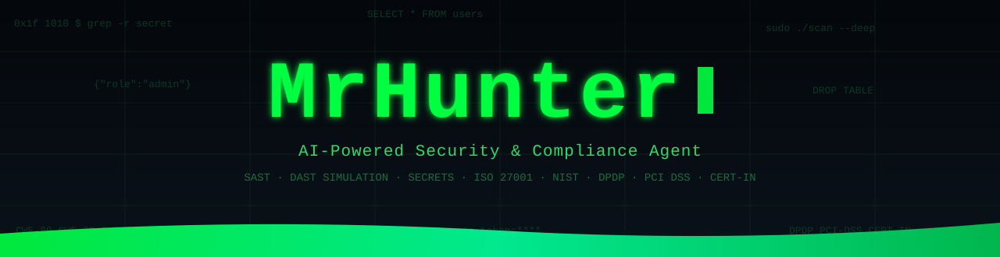
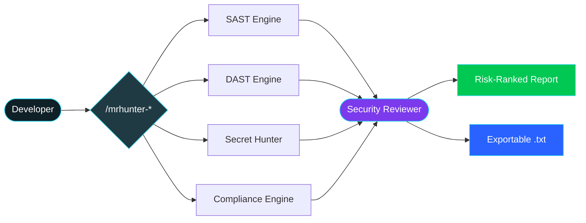

<div align="center">



<a href="#09---quick-start">
  
</a>

<br/><br/>

<a href="#09---quick-start"></a>
<a href="#11---commands"></a>
<a href="#12---why-teams-choose-mrhunter"></a>
<a href="https://github.com/TheWildEye/MrHunter2/issues"></a>
<a href="#16---credits"></a>

<br/><br/>

### The security & compliance brain that lives inside your editor.
**No servers. No API keys. No cloud. No noise.** Open your project, run one command, get a board-ready security and compliance verdict in seconds.

**SAST · DAST simulation · Secret hunting · Compliance.** Five engines, one command, zero infrastructure.


</div>

---

<div align="center">

## 01 · 🎬 See It In Action

<a href="#09---quick-start">

</a>

<sub>a live MrHunter scan, from one command to a board-ready verdict in seconds</sub>


</div>

---

<div align="center">

## 02 · 🏆 Trusted Where It Counts

<table>
<tr>
<td align="center" width="25%">
<h1>150K+</h1>
<b>Businesses Protected</b><br/>
<sub>across the platforms we've secured</sub>
</td>
<td align="center" width="25%">
<h1>10+</h1>
<b>Products Audited</b><br/>
<sub>security &amp; GRC end-to-end</sub>
</td>
<td align="center" width="25%">
<h1>100+</h1>
<b>Vulnerabilities Found</b><br/>
<sub>critical, high &amp; compliance</sub>
</td>
<td align="center" width="25%">
<h1>50+</h1>
<b>GRC Audit Reports</b><br/>
<sub>shipped to leadership</sub>
</td>
</tr>
</table>


<br/>

**Trusted across industries**


</div>

---

<div align="center">

## 03 · 🚨 The Reality Most Teams Ignore

<table>
<tr>
<th>The Old Way</th>
<th>The MrHunter Way</th>
</tr>
<tr>
<td>Security reviews happen <b>after</b> the sprint</td>
<td>Security is <b>inside</b> the editor, as you build</td>
</tr>
<tr>
<td>₹ lac / $ k spent on heavyweight scanner licenses</td>
<td><b>Zero infrastructure.</b> Zero license fees. Zero API keys.</td>
</tr>
<tr>
<td>500-line reports nobody reads</td>
<td><b>Plain-English verdicts</b> managers &amp; CISOs actually act on</td>
</tr>
<tr>
<td>Compliance discovered at audit time</td>
<td>DPDP, PCI DSS, CERT-IN &amp; more checked <b>on every scan</b></td>
</tr>
<tr>
<td>Findings without proof</td>
<td><b>Evidence-first:</b> exact file, line, and data flow</td>
</tr>
</table>


</div>

---

<div align="center">

## 04 · 🧩 What MrHunter Does

Five specialized engines behind one command.


</div>

### SAST: Static Analysis
Deep code reasoning across **Python, JS/TS, Java, Go, PHP, Ruby, Kotlin &amp; Swift**.
- SQLi, command injection, XSS, SSRF, XXE, deserialization, path traversal and more
- Taint tracing from user input to the dangerous sink
- Logic-over-patterns engine: fewer false positives, more real bugs

### DAST Simulation
Runtime attack simulation with zero network calls.
- Models REST, GraphQL, WebSocket, gRPC and OAuth/OIDC flows
- Simulates auth bypass, BOLA/IDOR, mass assignment and race conditions
- Traces full exploit chains, not isolated symptoms

### Secret Hunter
Scans every file, including `.env` and gitignored files.
- 35+ credential types: AWS, GCP, Azure, Stripe, Razorpay, OpenAI, Anthropic, Gemini, Slack, private keys and more
- Flags gitignored vs. committed so you know the blast radius instantly

### Compliance Engine
Global standards plus seven Indian regulatory frameworks, mapped to your code.
- ISO/IEC 27001 · NIST SP 800-53
- DPDP Act 2023 · IT Act 2000 · PCI DSS 4.0.1
- CERT-IN 2022 · RBI · SEBI CSCRF · IRDAI
- Exact control/section and penalty exposure for every finding

### Security Reviewer: The Triage Layer
Deduplicates, cross-references and risk-ranks findings from the other engines.
- CVSS v4.0 + OWASP Risk Rating scoring
- Removes false positives, verifies reachability, separates real from theoretical
- Produces one board-ready report: technical depth for engineers, plain English for leadership

---

<div align="center">

## 05 · 🔌 Bring Your Own Agent (BYOA)

MrHunter is agent-agnostic. Drop the same skill pack into any AI coding agent you already use.


</div>

Works with **Claude Code**, **Gemini / Antigravity**, **ChatGPT Codex**, **OpenCode**, **Cursor**, **Windsurf**, **Cline** and more.

- No lock-in: your agent, your choice
- One skill pack, every agent: write once, run anywhere
- Zero infra: runs locally, inside your editor
- Future-proof: swap agents anytime, keep MrHunter

<sub>Same engines, same reports, same compliance verdicts, whichever agent you point at your code.</sub>

---

<div align="center">

## 06 · 📋 Audit &amp; GRC: Governance, Risk &amp; Compliance

MrHunter isn't just a scanner, it's a **GRC co-pilot**. It turns raw code findings into **audit-ready evidence**, maps every issue to a control framework, and quantifies the **business &amp; legal risk** leadership cares about.

### Global standards
| Standard | What MrHunter Maps | Why It Matters |
|---|---|---|
| **ISO/IEC 27001** | Access control, cryptography, logging &amp; monitoring, secure SDLC (Annex A controls) | Clears enterprise &amp; vendor security questionnaires |
| **NIST SP 800-53** | AC · AU · SC · SI · RA control families | Required for regulated &amp; government procurement |

###  Indian regulatory frameworks
| Framework | What MrHunter Checks | Why It Matters |
|---|---|---|
| **DPDP Act 2023** | Consent, children's data, breach readiness, erasure | Penalties up to **₹250 Cr** |
| **IT Act 2000** | SPDI safeguards, disclosure, confidentiality | Criminal + civil liability |
| **PCI DSS 4.0.1** | PAN/CVV storage, TLS, MFA, logging | Card-brand fines &amp; suspension |
| **CERT-IN 2022** | 6-hour reporting, 180-day logs, NTP, MFA | Statutory obligation |
| **RBI Cyber 2024** | Device binding, tokenization, rate limits | PSS Act penalties |
| **SEBI CSCRF** | Data classification, SOC, VAPT, SBOM | Exchange + SEBI action |
| **IRDAI Cyber** | PII/health encryption, board policy, VAPT | Discretionary + IT Act |

### Built for audit season
- **Evidence-first** findings (file + line + data flow), defensible in a VAPT report
- **Control mapping**, every finding ties to a framework control
- **Penalty exposure in ₹ / $**, plain-English risk for the board
- **One-click audit report export**, hand it straight to auditors &amp; leadership


</div>

---

<div align="center">

## 07 · 🏗️ Architecture

**One command fans out to five engines. One reviewer unifies the verdict.**


</div>



```
your-project/
├── opencode.json                 # Registers the 5 subagents
├── AGENTS.md                     # Session context (auto-loaded)
└── .opencode/
    ├── commands/                 # Slash command entry points
    ├── agents/                   # The 5 reasoning engines
    └── skills/                   # OWASP · CWE · Mobile · Legal knowledge
```

---

<div align="center">

## 08 · 🛡️ Built on Zero Trust

MrHunter follows a **Zero Trust** model, *never trust, always verify*, applied to the scanner itself. Nothing about your code, secrets, or findings is implicitly trusted with any external system.


</div>

| Zero Trust Pillar | How MrHunter Proves It |
|---|---|
| **Verify explicitly** | Every finding is evidence-first, a verified `source → sink` data flow, never a keyword guess |
| **Least privilege** | Runs as a local, read-only agent, `edit`, `bash` and `webfetch` are **denied** by default |
| **Assume breach** | Treats all input as hostile, prompt injection, malicious files and payloads are neutralized, not trusted |
| **No implicit network trust** | **Zero external calls** during scans, no code, secrets or findings ever leave your machine |
| **Continuous verification** | A fresh scan every session, stale findings are never reused or trusted |
| **No shared trust** | No cloud, no telemetry, no third-party dependency in the scan path |

<sub>No servers. No telemetry. Nothing leaves your machine, a zero-trust, local-first agent by design.</sub>

---

<div align="center">

## 09 · 🚀 Quick Start

**Prerequisite:** [OpenCode](https://opencode.ai) + Git. That's it. No `npm`, no `pip`, no keys.

**1 · From your project root, install MrHunter**

macOS / Linux
```bash
curl -fsSL https://raw.githubusercontent.com/TheWildEye/MrHunter2/main/install.sh | bash
```

Windows (PowerShell)
```powershell
irm https://raw.githubusercontent.com/TheWildEye/MrHunter2/main/install.ps1 | iex
```

**2 · Open your project in OpenCode, then scan**

```bash
opencode
```

```
/mrhunter-quick-scan
```

Want it in **every** project? Add `--global` (macOS/Linux) or `-Global` (Windows) to the install command.

That's it. **No background services. Nothing leaves your machine.**


</div>

---

<div align="center">

## 10 · 📦 Manual Install

Prefer to do it by hand? Just clone and copy. No scripts, no surprises.


</div>

**macOS / Linux**
```bash
git clone --depth 1 https://github.com/TheWildEye/MrHunter2.git _mrhunter
cp -r _mrhunter/MrHunter/.opencode ./
cp _mrhunter/MrHunter/opencode.json _mrhunter/MrHunter/AGENTS.md ./
rm -rf _mrhunter
```

**Windows (PowerShell)**
```powershell
git clone --depth 1 https://github.com/TheWildEye/MrHunter2.git _mrhunter
Copy-Item -Recurse _mrhunter/MrHunter/.opencode ./
Copy-Item _mrhunter/MrHunter/opencode.json, _mrhunter/MrHunter/AGENTS.md ./
Remove-Item -Recurse -Force _mrhunter
```

Then open OpenCode in your project and run `/mrhunter-quick-scan`.

---

<div align="center">

## 11 · 🎯 Commands

| Command | What It Does | Best For |
|---|---|---|
| <kbd>/mrhunter-security-assess</kbd> | **Full VAPT**, SAST + DAST + secrets + compliance, risk-ranked | Pre-release &amp; sprint sign-off |
| <kbd>/mrhunter-quick-scan</kbd> | **Fast SAST + secret scan**, no DAST, no compliance | Every commit, fast feedback |
| <kbd>/mrhunter-compliance-audit</kbd> | **Deep Indian regulatory audit** across 7 frameworks | Audits, board &amp; CISO reviews |
| <kbd>/mrhunter-fix-issue</kbd> | **Remediation advisor**, exact before/after fix guidance | Fixing a specific finding |

Every report ends with an optional **one-click `.txt` export**, technical detail *and* a plain-English management summary.


</div>

---

<div align="center">

## 12 · 💡 Why Teams Choose MrHunter

| Role | What they get |
|---|---|
| **Team Leads** | Catch issues before code review, one command, no CI wiring |
| **Security Engineers** | AppSec + product coverage, taint-aware SAST, source → sink evidence |
| **Software Engineers** | Before / after fix guidance, no new tooling, runs in your editor |
| **DevSecOps** | Drops into any CI/CD, key-free, gate merges on real findings |
| **CISOs** | Compliance exposure quantified, evidence-first, frameworks mapped to code |
| **Managers** | Plain-English risk summaries, penalty exposure in ₹ / $ |


</div>

---

<div align="center">

## 13 · 📊 How We Compare

| Capability | Traditional Scanners | MrHunter |
|---|---|---|
| Static analysis (SAST) | Yes | Yes |
| Runtime attack simulation (DAST) | Separate product | Built-in |
| Secret detection | Limited | 35+ types |
| Compliance mapping | No | ISO 27001 · NIST + 7 Indian laws |
| Zero infrastructure | No | Yes |
| Business-ready reports | Limited | Yes |
| Cost | Licensed | Zero |
| Runs inside your editor | No | Yes |


</div>

---

<div align="center">

## 14 · ❓ FAQ

<details>
<summary><b>Does my code ever leave my machine?</b></summary>
<br/>
<b>Never.</b> Everything runs locally on your own files. There are no external calls, no telemetry, and no data exfiltration.
</details>

<details>
<summary><b>Do I need API keys or a paid scanner?</b></summary>
<br/>
No. It works purely by reasoning over your codebase. No keys, no servers, no licenses.
</details>

<details>
<summary><b>What do I need to run it?</b></summary>
<br/>
Just an AI coding agent (like OpenCode) and Git. No Python, Node, Docker, database, or other dependencies.
</details>

<details>
<summary><b>Does it actually understand my code, or just grep?</b></summary>
<br/>
It reasons. It traces <i>source → sink</i> data flows, verifies reachability, detects existing sanitization, and separates real vulnerabilities from false positives.
</details>

<details>
<summary><b>Is it safe to run on a repo containing prompt-injection attempts?</b></summary>
<br/>
Yes. Any file trying to hijack the agent is flagged as a <b>CWE-77</b> finding and ignored, and the scan continues unchanged.
</details>

<details>
<summary><b>Which languages are supported?</b></summary>
<br/>
Python, JavaScript/TypeScript, Java, Go, PHP, Ruby, Kotlin, and Swift, with OWASP Top 10, CWE Top 25 &amp; OWASP API Top 10 coverage.
</details>


</div>

---

<div align="center">

## 15 · 💬 Wall of Love


</div>

---

<div align="center">

## 16 · 👥 Credits

<table>
<tr>
<td align="center" width="50%">

**Vyom Nagpal** · Builder
<br/>
Security Engineering &amp; GRC
<br/><br/>
<a href="mailto:vyomnagpal7@gmail.com"></a>
<br/>
<a href="https://www.linkedin.com/in/vyomnagpal"></a>

</td>
<td align="center" width="50%">

**Sahil Patel** · Collaborator
<br/>
Data Science @ Petpooja
<br/><br/>
<a href="https://www.linkedin.com/in/sahil-patel1815/"></a>

</td>
</tr>
</table>

**Found a false positive? Want a new check?**
Open an [issue](https://github.com/TheWildEye/MrHunter2/issues) or reach out, we ship fast.


</div>

---

<div align="center">

## 17 · 📄 License

Released under the **MIT License**, free to use, fork, and extend.

<br/>

**If MrHunter saved you time (or a penalty), drop a star, it fuels the next engine.**


<br/>


</div>
